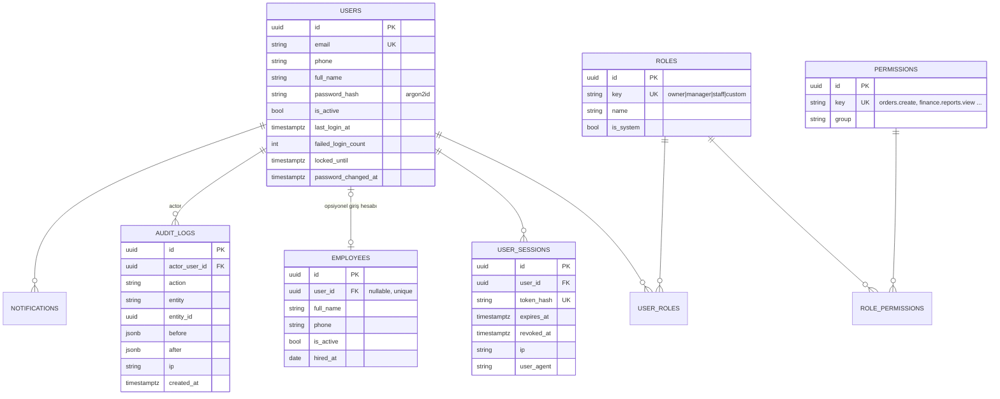
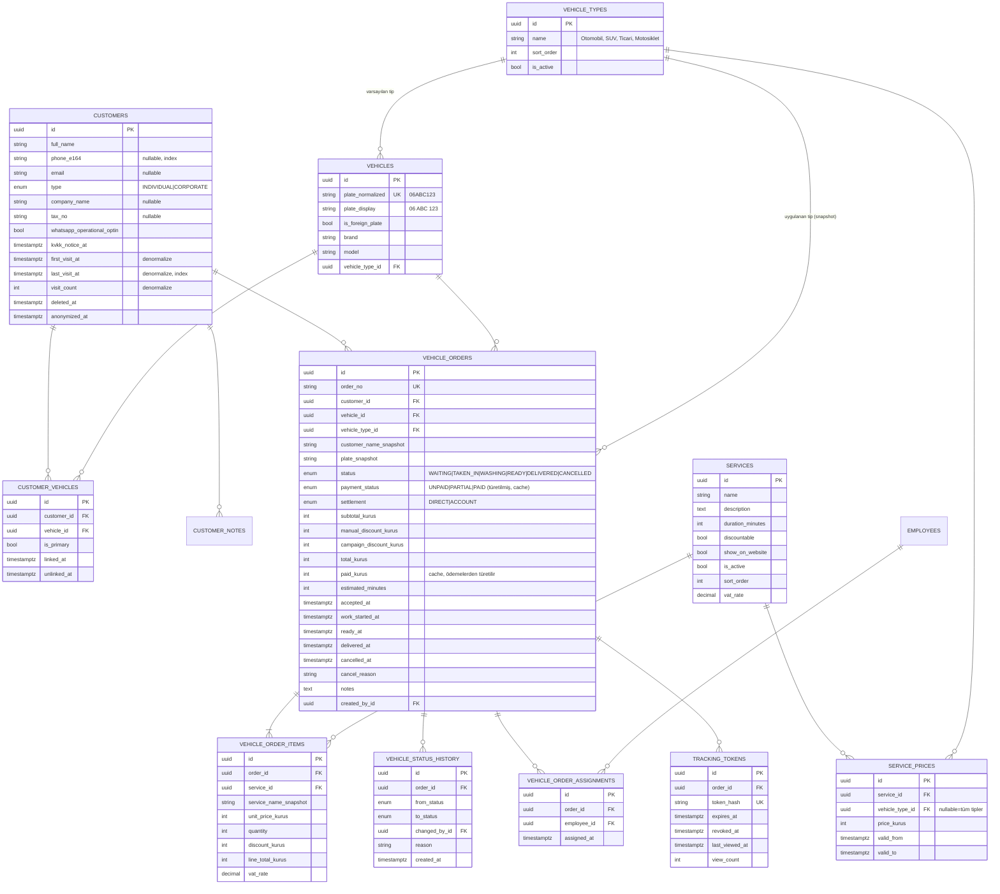
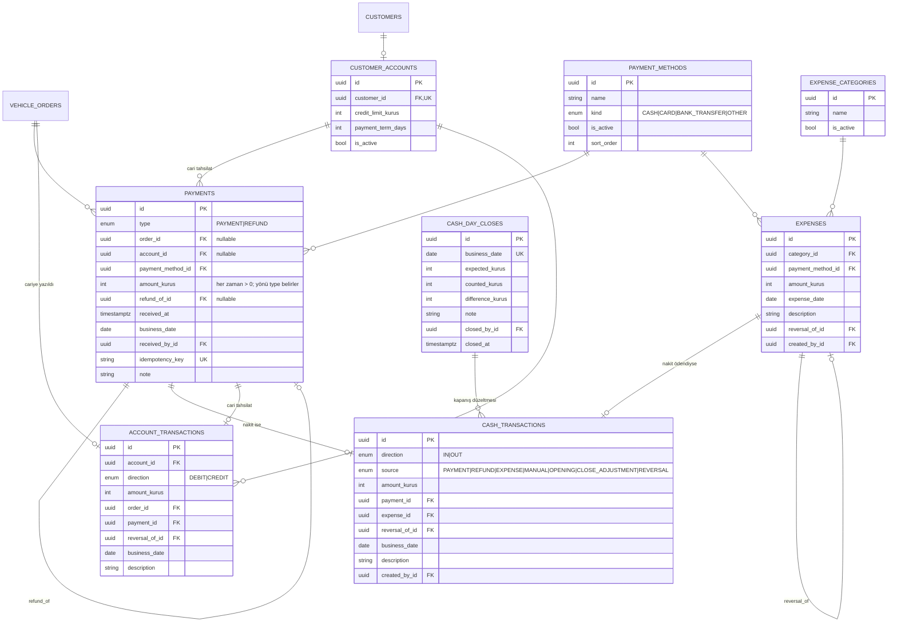
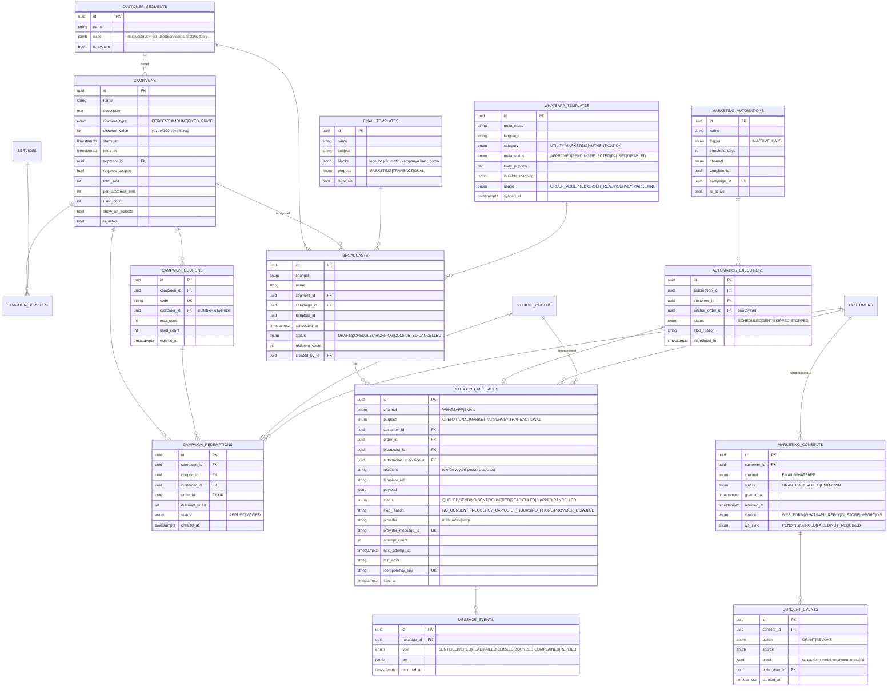
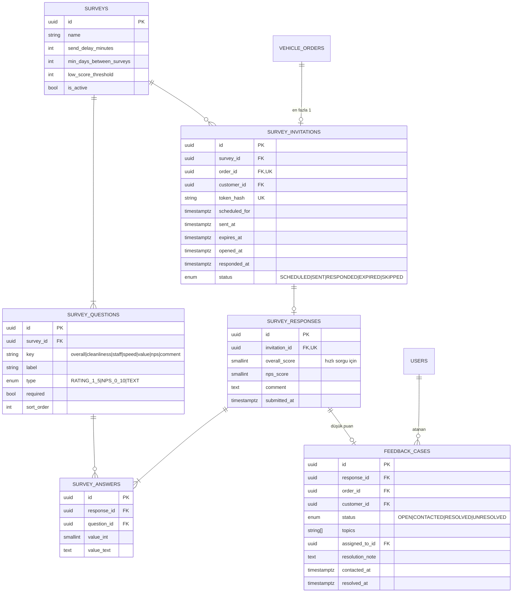
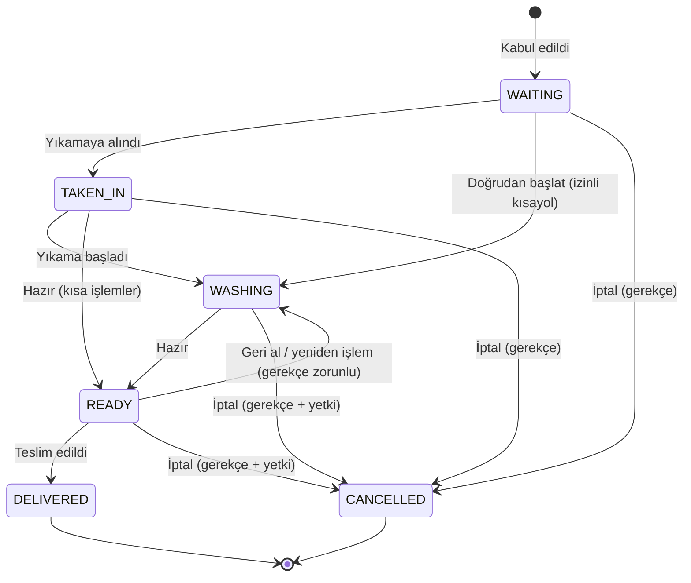

# 02 — Veritabanı ERD, Araç Durum Akışı, Finansal Veri Modeli

---

## 5. Veritabanı ERD ve Tablo İlişkileri

### 5.1 Genel kurallar (tüm tablolar)

| Konu | Kural |
|---|---|
| Birincil anahtar | `id uuid` (UUIDv7 — zaman sıralı, index dostu). Kullanıcıya gösterilen numaralar ayrı: `order_no` (örn. `2026-000123`). |
| Zaman | Tüm zaman damgaları `timestamptz`, UTC saklanır. "İş günü" (`business_date date`) gereken yerde ayrıca saklanır ve Europe/Istanbul'a göre hesaplanır (gün sonu, gider tarihi). |
| Denetim alanları | `created_at`, `updated_at`; değiştirilebilir tablolarda `created_by_id`, `updated_by_id`. |
| Para | `*_kurus integer` (750,00 TL = `75000`). Toplamlar SQL'de `bigint`. **Float asla kullanılmaz.** Para birimi sabit TRY (ayarlarda tek değer). |
| Soft delete | Sadece **referans/ana veri**: `customers`, `vehicles`, `services`, `employees`, `users`, `campaigns`, `expense_categories`, `payment_methods` → `deleted_at` / `is_active`. |
| Silinemez (append-only) | `payments`, `cash_transactions`, `account_transactions`, `expenses`, `vehicle_status_history`, `audit_logs`, `consent_events`, `outbound_messages`. Düzeltme = ters kayıt. Uygulama katmanına ek olarak **PostgreSQL trigger** ile `UPDATE` (tutar alanları) ve `DELETE` engellenir. |
| Enum | PostgreSQL enum yerine Prisma enum (migration ile yönetilir). Kullanıcının yönetebileceği listeler (ödeme yöntemi, gider kategorisi, araç tipi) **tablo**dur, enum değil. |
| Gizli bilgiler | Entegrasyon token'ları `integration_settings.secret_encrypted` (AES-256-GCM, anahtar `.env`'de `APP_ENCRYPTION_KEY`). Takip/anket/abonelik token'ları **sadece hash** olarak saklanır. |

### 5.2 Önerilen tablolar (V1) ve dokümandaki öneriyle farklar

| Doküman önerisi | Karar | Gerekçe |
|---|---|---|
| Users, Roles, Permissions | ✅ + `role_permissions`, `user_roles`, `user_sessions` | Çoktan çoğa ilişkiler ve sunucu tarafı oturum. |
| Employees | ✅ ama **Users'tan ayrı** | Her personel sisteme giriş yapmaz ama performans raporunda yer alır. `employees.user_id` isteğe bağlı. |
| Customers, Vehicles, CustomerVehicles | ✅ | Plaka `vehicles.plate_normalized` UNIQUE. |
| Services, ServicePrices | ✅ + `vehicle_types` | Fiyat araç tipine göre ve tarihli (geçmiş korunur). |
| VehicleOrders, VehicleOrderItems, VehicleStatusHistory | ✅ + `vehicle_order_assignments` | Çoklu personel (E-02). |
| Payments, PaymentMethods | ✅ | İade dahil tek tablo, `type` ile. |
| Expenses, ExpenseCategories | ✅ | |
| CashTransactions | ✅ + `cash_day_closes` | Gün sonu sayımı ve fark kaydı. |
| CustomerAccounts, AccountTransactions | ✅ | Kurumsal cari. |
| Campaigns, CampaignCoupons, CampaignRedemptions | ✅ + `campaign_services` | |
| CustomerSegments | ✅ (kural tabanlı, JSON tanım) | Üyeler saklanmaz, gönderim anında hesaplanır; gönderilen liste `outbound_messages`'ta kalır. |
| MarketingConsents | ✅ + `consent_events` | Mevcut durum + değiştirilemez olay geçmişi (kanıt). |
| EmailTemplates, WhatsAppTemplates | ✅ (iki ayrı tablo) | Doğaları farklı: e-posta serbest içerik, WhatsApp Meta onaylı şablon aynası. |
| EmailCampaigns | ➡ `broadcasts` (kanal alanıyla) | E-posta ve WhatsApp toplu gönderimi aynı yaşam döngüsüne sahip. |
| EmailMessages, WhatsAppMessages | ➡ **tek `outbound_messages`** + `message_events` | Frekans sınırı, "bu müşteriye son 7 günde kaç pazarlama mesajı gitti" sorgusu ve outbox deseni tek tabloyla doğru çalışır. Kanal özgü alanlar `jsonb`. |
| MarketingAutomations, AutomationExecutions | ✅ | |
| Surveys, SurveyQuestions, SurveyResponses | ✅ + `survey_invitations`, `survey_answers` | Davet (token, zamanlama) ile yanıt ayrı. |
| CustomerFeedback | ➡ `feedback_cases` | Şikâyet yaşam döngüsü (açık → iletişime geçildi → çözüldü). |
| Notifications | ✅ (panel içi) | |
| AuditLogs | ✅ | |
| BusinessSettings | ✅ (`business_settings` tek satır tipli) + `integration_settings` | |
| WebsiteContents | ✅ + `website_faqs`, `website_testimonials` | |
| TrackingTokens | ✅ | |
| — | ➕ `customer_notes` | Müşteri notları tarihli ve yazarlı olmalı. |
| — | ➕ `uploads` | Logo/site görselleri meta verisi. |
| — | ➕ `order_number_sequences` (veya PG sequence) | Yıl bazlı sıra numarası. |

**Toplam V1 tablo sayısı ≈ 45.** Gereksiz tablo yok; her biri bir ekran veya bir rapor tarafından kullanılıyor.

### 5.3 ERD — Kimlik, yetki, personel



### 5.4 ERD — Müşteri, araç, katalog, araç kabul



**Kısıtlar ve indexler (önemli olanlar):**

- `vehicles.plate_normalized` UNIQUE.
- `customer_vehicles (customer_id, vehicle_id)` UNIQUE WHERE `unlinked_at IS NULL`.
- `customers.phone_e164` index (UNIQUE değil — aynı telefonla iki kayıt birleştirme aracıyla çözülür; UNIQUE yapmak sahada yanlış veri girildiğinde kabulü kilitler). Kabul ekranı aynı telefonlu müşteriyi **önerir**.
- `vehicle_orders (status, accepted_at)`, `(customer_id, accepted_at)`, `(delivered_at)` indexleri.
- Kısmi index: "aktif araçlar" `WHERE status NOT IN ('DELIVERED','CANCELLED')`.
- Aynı araç için aynı anda **birden fazla aktif kabul** engellenir: `UNIQUE (vehicle_id) WHERE status NOT IN ('DELIVERED','CANCELLED')`.
- `CHECK (total_kurus = subtotal_kurus - manual_discount_kurus - campaign_discount_kurus AND total_kurus >= 0)`.

### 5.5 ERD — Finans



### 5.6 ERD — Kampanya, izin, mesajlaşma, otomasyon



`automation_executions (automation_id, customer_id, anchor_order_id)` UNIQUE → aynı "gelmeme dönemi" içinde aynı otomasyon aynı müşteriye **ikinci kez** gönderilemez.

### 5.7 ERD — Anket, şikâyet, site, ayarlar



Site/ayar tabloları (ilişkisi basit, diyagrama eklenmedi): `business_settings` (tek satır: ad, unvan, logo, renkler, adres, telefon, WhatsApp no, harita koordinatı, çalışma saatleri `jsonb`, sosyal medya, sessiz saatler, frekans sınırları, takip token süresi), `integration_settings` (provider, config `jsonb`, secret_encrypted, is_enabled, last_test_at, last_test_result), `website_content` (anahtar–değer bölümler: hero, hakkımızda, SEO meta), `website_faqs`, `website_testimonials` (sadece onaylı ankette "yayınlanabilir" işaretlenen veya elle girilen), `uploads`, `notifications`.

---

## 6. Araç Kabul ve Durum Geçiş Diyagramı

### 6.1 Araç kabul akışı (hedef: 30 saniyenin altında)

```mermaid
flowchart TD
  A[Plaka gir] --> B[Normalize et<br/>'06 abc-123' → '06ABC123']
  B --> C{Araç kayıtlı mı?}
  C -- Evet --> D[Bağlı müşteri(ler)i getir<br/>son hizmet, açık borç, notlar, izin durumu]
  C -- Hayır --> E[Yeni araç formu<br/>tip, marka/model opsiyonel]
  D --> F{Müşteri doğru mu?}
  F -- Evet --> H
  F -- Farklı kişi getirdi --> G[Telefonla ara / yeni müşteri oluştur<br/>araca bağla]
  E --> G2[Telefon ile müşteri ara<br/>yoksa yeni müşteri]
  G --> H
  G2 --> H
  H{Aracın aktif kaydı var mı?} -- Evet --> X[Engelle: 'Bu araç zaten işlemde' + kayda git]
  H -- Hayır --> I[Hizmet seç<br/>fiyat araç tipine göre otomatik]
  I --> J[Kupon / kampanya<br/>backend uygunluk kontrolü]
  J --> K[Manuel indirim<br/>yetki + limit kontrolü]
  K --> L[Personel ata · not · tahmini süre]
  L --> M[Kaydet — TEK TRANSACTION]
  M --> M1[vehicle_orders + items + status_history]
  M --> M2[campaign_redemption + used_count artışı]
  M --> M3[tracking_token]
  M --> M4[outbound_message ORDER_ACCEPTED<br/>status=QUEUED — outbox]
  M --> M5[audit_log]
  M --> N[Commit → worker mesajı gönderir<br/>hata olursa kabul ETKİLENMEZ]
  M --> P{Peşin ödeme var mı?}
  P -- Evet --> Q[Ödeme kaydı ayrı işlem olarak]
```

### 6.2 Durum makinesi



| Durum (kod) | Arayüz | Zaman damgası |
|---|---|---|
| `WAITING` | Bekliyor | `accepted_at` |
| `TAKEN_IN` | Yıkamaya alındı | `work_started_at` (ilk kez set edilir) |
| `WASHING` | Yıkama devam ediyor | `work_started_at` (henüz yoksa) |
| `READY` | Hazır | `ready_at` (son hazır olma anı) |
| `DELIVERED` | Teslim edildi | `delivered_at` |
| `CANCELLED` | İptal edildi | `cancelled_at` |

**Geçiş kuralları (backend'de zorunlu):**

1. Tanımsız geçiş → `409 ORDER_INVALID_TRANSITION`.
2. `DELIVERED` ve `CANCELLED` terminal. Düzeltme sadece `orders.correct_status` yetkisiyle, gerekçe zorunlu, audit log'lu, raporlara düzeltme olarak yansır.
3. **İptal:** net tahsilat (ödemeler − iadeler) > 0 ise iptal engellenir → önce iade. Kampanya kullanımı `VOIDED` yapılır, `used_count` geri alınır.
4. **Teslim ödeme durumundan bağımsızdır.** Ödenmemiş teslimde uyarı gösterilir (personel onaylar), kayıt alacak olarak kalır veya kurumsal müşteride cariye yazılır.
5. Her geçiş `vehicle_status_history`'ye yazılır (kim, ne zaman, gerekçe).
6. Eşzamanlılık: geçiş `UPDATE ... WHERE id = ? AND status = <beklenen>` ile yapılır; iki personel aynı anda basarsa ikincisi "kayıt güncellendi, yenileyin" alır.

**Yan etkiler (domain olayları → outbox):**

| Geçiş | Yan etki | Tekrar önleme |
|---|---|---|
| → `WAITING` (kabul) | "Araç kabul" WhatsApp mesajı (+ takip linki), müşteri `visit_count/last_visit_at` güncelle, devam eden geri kazanım otomasyonlarını **durdur** | `idempotency_key = order:{id}:ACCEPTED` |
| → `READY` | "Araç hazır" WhatsApp mesajı | `order:{id}:READY` — geri alıp tekrar hazır yapmak **otomatik ikinci mesaj göndermez**; panelden "tekrar gönder" butonu (bilinçli) |
| → `DELIVERED` | Anket daveti `scheduled_for = delivered_at + gecikme`; takip token süresi `delivered_at + 24 saat`; ciro tanınır | `survey_invitations.order_id` UNIQUE |
| → `CANCELLED` | Planlanmış mesajlar (QUEUED) iptal, takip token iptal | |

---

## 7. Finansal Veri Modeli ve Hesaplama Kuralları

### 7.1 Temel ilke: dört ayrı kavram asla karıştırılmaz

| Kavram | Tanım | Kaynak | Hangi tarihe göre |
|---|---|---|---|
| **Ciro (net satış)** | Teslim edilmiş, iptal edilmemiş araçların indirim sonrası toplamı | `vehicle_orders.total_kurus` WHERE `status=DELIVERED` | `delivered_at` (İstanbul günü) |
| **Brüt satış / İndirim** | Liste fiyatı toplamı; manuel + kampanya indirimleri ayrı | `subtotal_kurus`, `manual_discount_kurus`, `campaign_discount_kurus` | `delivered_at` |
| **Tahsilat** | Gerçekten alınan para − iadeler | `payments` (PAYMENT − REFUND) | `received_at` |
| **Alacak** | Teslim edilmiş ama tahsil edilmemiş tutar (araç bazlı) + cari hesap bakiyeleri | `total − net_paid` (DIRECT), `Σ DEBIT − Σ CREDIT` (ACCOUNT) | Anlık / tarih itibarıyla |
| **Alınan avans** | Henüz teslim edilmemiş araçlara alınan ödeme | aktif araçlardaki net ödeme | Anlık |
| **Gider** | Girilen giderler − ters kayıtlar | `expenses` | `expense_date` |

**Ödenmemiş hizmet asla tahsilat veya kasa gibi gösterilmez.** Dashboard'da "Günlük ciro" ve "Günlük tahsilat" yan yana ama ayrı kartlardır; altında "Bekleyen alacak" ayrı karttır.

### 7.2 Hesaplama kuralları

1. **Kuruş aritmetiği.** Tüm hesaplar tamsayı kuruşla. Yüzde indirim: `round_half_up(base × pct / 10000)`. İndirim kalemlere **en büyük kalan yöntemiyle** dağıtılır (kalem toplamları her zaman sipariş toplamına eşit olur; hizmet bazlı gelir raporu kuruşu kuruşuna tutar).
2. **Fiyat snapshot.** Kabulde: `service_name_snapshot`, `unit_price_kurus`, `vat_rate` kaleme yazılır. Hizmet fiyatı sonradan değişirse geçmiş kayıt değişmez. Fiyat değişikliği yeni `service_prices` satırıdır (`valid_from`).
3. **Ödeme durumu (türetilmiş):**
   - `net_paid = Σ PAYMENT − Σ REFUND` (siparişe bağlı)
   - `net_paid = 0` → `UNPAID`; `0 < net_paid < total` → `PARTIAL`; `net_paid = total` → `PAID`.
   - `settlement = ACCOUNT` → arayüzde "Cariye yazıldı" (sipariş kendi üzerinde alacak taşımaz).
   - Değer cache'lenir (`paid_kurus`, `payment_status`) ama **her ödeme işlemi aynı transaction'da yeniden hesaplar**; tutarlılık için gece kontrol işi (reconciliation) farkları raporlar.
4. **Fazla ödeme engeli:** `amount ≤ total − net_paid`. İade: `amount ≤ orijinal ödeme − o ödemeye yapılmış iadeler`.
5. **Örnek (dokümandaki):** Toplam 750 TL → 300 TL nakit (PAYMENT, CASH → kasaya IN 300) → 450 TL kart (PAYMENT, CARD, kasaya girmez) → `net_paid = 750`, `PAID`. Gün sonu: kasa +300, kart +450, tahsilat 750.
6. **Toplam değişikliği:** Ödemesi alınmış araçta kalem çıkarılıp toplam `net_paid`'in altına düşerse işlem engellenir → önce iade.
7. **Kampanya indirimi maliyeti** = `Σ campaign_discount_kurus` (teslim edilmiş araçlarda). Manuel indirimler ayrı raporlanır.
8. **İptal edilen araçlar** ciroya girmez; raporda ayrı adet ve "kaybedilen potansiyel tutar" olarak gösterilir.

### 7.3 Kasa (sadece nakit)

```
Beklenen kasa (gün) = Açılış devri
                    + Σ nakit tahsilat
                    − Σ nakit iade
                    − Σ nakit ödenen gider
                    ± Σ manuel giriş/çıkış (gerekçeli, yetkili)
```

- **Gün sonu:** Yetkili kişi sayılan tutarı girer → `difference = counted − expected`. Fark ≠ 0 ise gerekçe zorunlu, `CLOSE_ADJUSTMENT` kasa hareketi oluşur. Kapanmış güne yeni nakit hareketi **yazılamaz** (geç kayıt bir sonraki güne düşer veya yetkili "gün açma" işlemi, audit log'lu).
- Ertesi günün açılışı = önceki günün sayılan tutarı (kasada bırakılan para; bankaya yatırılan kısım "manuel çıkış: bankaya yatırıldı").
- Gün sonu raporu: nakit / kart / havale / diğer tahsilat, iadeler, nakit giderler, beklenen vs sayılan, o gün teslim edilip ödenmeyenler, o gün tahsil edilen eski alacaklar.

### 7.4 Cari hesap (kurumsal)

- Sipariş "cariye yaz" → `ACCOUNT_TRANSACTIONS DEBIT (order_id)`, sipariş `settlement = ACCOUNT`.
- Cari tahsilat → `PAYMENTS (account_id, order_id=NULL)` + `ACCOUNT_TRANSACTIONS CREDIT (payment_id)`.
- Bakiye = Σ DEBIT − Σ CREDIT. Ekstre: açılış bakiyesi (dönem öncesi) + dönem hareketleri + kapanış bakiyesi.
- Kredi limiti aşılırsa uyarı (engel değil, ayarlanabilir).
- V1'de cari tahsilatın tek tek siparişlere eşleştirilmesi (fatura kapatma) **yok**; bakiye bazlı çalışır. Gerekirse sonradan eklenebilir.

### 7.5 Silinemezlik ve düzeltme

| Hata | Düzeltme |
|---|---|
| Yanlış tutarlı ödeme | İade (REFUND) + doğru ödeme. Her ikisi de görünür. |
| Yanlış yönteme yazılan ödeme | Aynı: iade + yeni ödeme (gün kapanmadıysa tek tıkla "yöntem düzelt" = bu iki kaydı otomatik oluşturur). |
| Yanlış gider | `reverse` → aynı tutarda `reversal_of_id` ile ters kayıt. |
| Yanlış manuel kasa hareketi | Ters kasa hareketi (`REVERSAL`). |

Tümü audit log'a yazılır. Veritabanı trigger'ı finansal tablolarda `DELETE`'i ve tutar/tarih alanlarında `UPDATE`'i reddeder.

### 7.6 Kârlılık beyanı kuralı

Sistem raporlarda **"Kâr"** kelimesini kullanmaz. Kullanılan ifadeler:

- "Tahsilat − Gider (nakit bazlı fark)"
- "Ciro − Gider (girilen giderlere göre)"

Raporun altında uyarı: *"Bu tutar sadece sisteme girilen giderleri kapsar; vergi, amortisman, POS komisyonu gibi girilmemiş maliyetler dahil değildir. Muhasebe kârı değildir."*

### 7.7 Yetkiler (finans ilgili örnek anahtarlar)

`payments.create`, `payments.refund`, `orders.manual_discount` (limit parametreli), `orders.price_override`, `cash.manual_entry`, `cash.day_close`, `cash.reopen_day`, `expenses.create`, `expenses.reverse`, `accounts.manage`, `finance.reports.view`.

### 7.8 Varsayılan rol–yetki matrisi (işletme sahibi düzenleyebilir)

| Yetki grubu | Sahip | Yönetici | Personel |
|---|:-:|:-:|:-:|
| Araç kabul / durum / teslim | ✅ | ✅ | ✅ |
| Müşteri görüntüle (telefon dahil) | ✅ | ✅ | ✅ (sadece işlemdeki araçlar + arama) |
| Müşteri düzenle / birleştir | ✅ | ✅ | ❌ |
| Ödeme al | ✅ | ✅ | ✅ |
| İade, manuel kasa, gün sonu | ✅ | ✅ | ❌ |
| Manuel indirim | ✅ (sınırsız) | ✅ (%20) | ✅ (%0 varsayılan) |
| Gider | ✅ | ✅ (ekle) | ❌ |
| Finansal raporlar | ✅ | ❌ (açılabilir) | ❌ |
| Operasyon raporları | ✅ | ✅ | ❌ |
| Kampanya / pazarlama | ✅ | ✅ | ❌ |
| Personel ve rol yönetimi | ✅ | ❌ | ❌ |
| Entegrasyon ayarları | ✅ | ❌ | ❌ |
| Site içeriği | ✅ | ✅ | ❌ |
| Audit log | ✅ | ❌ | ❌ |

Sahip rolü silinemez, sistemde en az bir aktif sahip bulunmak zorundadır.
