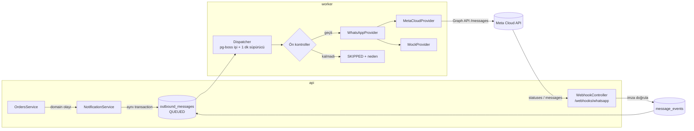
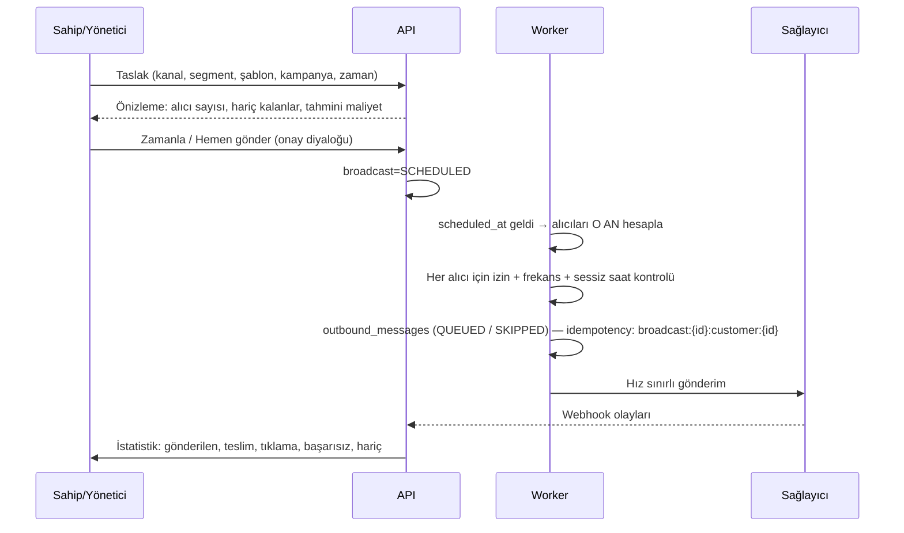

# 03 — WhatsApp, E-posta/Kampanya Otomasyonu, Anket, Raporlama Mimarileri

> Meta fiyatlandırması, şablon kategorileri ve İYS/KVKK yükümlülükleri sık değişir. Aşağıdaki politika varsayımları **geliştirme başlamadan önce güncel resmi kaynaklardan tekrar doğrulanacaktır**; sistem bu kuralları koda gömmek yerine ayarlanabilir tutar.

---

## 8. WhatsApp Entegrasyon Mimarisi

### 8.1 Ön koşullar (işletme tarafında)

1. Meta Business hesabı + işletme doğrulaması.
2. WhatsApp Business Account (WABA) + **başka bir WhatsApp uygulamasında kullanılmayan** bir telefon numarası (veya mevcut numaranın Cloud API'ye taşınması — o numara telefondaki WhatsApp Business uygulamasından çıkar; bu işletme için önemli bir operasyonel karar).
3. Kalıcı "System User" erişim token'ı, Phone Number ID, WABA ID, App Secret.
4. Şablonların Meta'ya gönderilip onaylanması (birkaç dakika–birkaç gün).

Bu süreç geliştirmeden bağımsız ilerlemeli; **Faz 7'den önce başlatılması önerilir** (Meta onay süreleri takvim riskidir).

### 8.2 Bileşenler



**Gönderim ön kontrolleri (sırasıyla):**

1. Entegrasyon aktif mi? Değilse → `SKIPPED (PROVIDER_DISABLED)` — **"gönderildi" gösterilmez.**
2. Alıcının geçerli E.164 telefonu var mı?
3. Amaca göre izin:
   - `OPERATIONAL` → `customers.whatsapp_operational_optin = true`
   - `MARKETING` → `marketing_consents(WHATSAPP).status = GRANTED` (+ İYS durumu, aktifse)
   - `SURVEY` → operasyonel izin + müşteri anket istemiyor işareti yok
4. Şablon `APPROVED` mı?
5. Pazarlamada: frekans sınırı ve sessiz saat (21:00–09:00 → bir sonraki uygun saate ertele).

### 8.3 Mesaj türleri ve şablonlar

| Kullanım | Kategori (beklenen) | Değişkenler | Buton |
|---|---|---|---|
| `ORDER_ACCEPTED` | Utility | `{{1}}` müşteri adı, `{{2}}` plaka | URL butonu: takip linki (dinamik son ek = token) |
| `ORDER_READY` | Utility | ad, plaka | — |
| `SURVEY` | Meta belirler (utility veya marketing) | ad, plaka | URL butonu: anket linki |
| `MARKETING_*` | Marketing | ad, kampanya, indirim, kupon, son tarih | URL (site/kampanya), Quick reply "Bildirimleri durdur" |

Dokümandaki metinler şablon gövdesi olarak kullanılacak. Şablon metnini panelden "değiştirmek" = Meta'ya yeni sürüm başvurusu; onaylanana kadar eski şablon kullanılmaya devam eder. Panelde bu durum açıkça gösterilir.

### 8.4 Güvenilirlik

| Gereksinim | Uygulama |
|---|---|
| Mesaj kuyruğu | `outbound_messages` = outbox (iş verisiyle aynı transaction'da yazılır, kayıp olamaz) + pg-boss işi. Süpürücü her dakika `QUEUED` ve `next_attempt_at <= now()` olanları `FOR UPDATE SKIP LOCKED` ile alır. |
| Tekrar önleme | `idempotency_key` UNIQUE (örn. `order:{id}:READY`). Meta'ya giden istek başarılı olup yanıt kaybolursa: `provider_message_id` ile webhook eşleşmesi; belirsiz durumda **yeniden gönderilmez**, "belirsiz" olarak işaretlenir (çift mesaj, kayıp mesajdan daha kötüdür kararı — ayarlanabilir). |
| Yeniden deneme | Geçici hatalar (ağ, 5xx, rate limit 429/130429): üstel bekleme 1 dk → 5 dk → 15 dk → 1 sa → 3 sa, max 5 deneme. Kalıcı hatalar (geçersiz numara, şablon duraklatıldı, kullanıcı WhatsApp'ta değil): denenmez, `FAILED` + Türkçe neden. |
| Operasyonel mesaj geç kalırsa | "Araç hazır" mesajı araç teslim edildikten sonra gönderilmek üzereyse → `CANCELLED (OUTDATED)`. Anlamsız mesaj gitmez. |
| Webhook doğrulama | `GET`: `hub.mode=subscribe` + `hub.verify_token` eşleşmesi → `hub.challenge`. `POST`: ham gövde üzerinden `X-Hub-Signature-256` HMAC-SHA256 (App Secret), sabit zamanlı karşılaştırma. İmza yoksa/yanlışsa 401 ve log. Olay işleme idempotent (aynı status iki kez gelebilir; durum sadece "ileri" gider: sent → delivered → read). |
| Gelen mesajlar | V1'de sadece: (a) "DUR/STOP/İPTAL" ve "Bildirimleri durdur" butonu → pazarlama izni iptal + `consent_event`, (b) anket hızlı yanıtları (kullanılırsa). Serbest metin mesajlar panelde **gösterilmez** (V1'de WhatsApp gelen kutusu yok); müşteriye işletmenin normal numarasını yönlendiren otomatik yanıt opsiyonu. |
| Gizli bilgiler | Token ve App Secret `integration_settings.secret_encrypted` (AES-256-GCM). Panelde maskeli gösterim (`EAAG…x9Q2`), "Bağlantıyı test et" butonu. Loglarda token ve telefon numarası maskelenir. |
| Mock sağlayıcı | API bilgisi yoksa varsayılan. Mesajı DB'ye `provider=mock` olarak yazar, panelde **"TEST MODU — gerçek mesaj gönderilmedi"** rozeti. Geliştirmede Meta webhook olayları da simüle edilebilir. |

### 8.5 Maliyet görünürlüğü

- Meta 2025'ten itibaren **mesaj başına** (şablon kategorisine göre) ücretlendirme modeline geçti; müşteri hizmet penceresi içindeki utility şablonların ücretsiz olması gibi kurallar var. Güncel durum geliştirme öncesi doğrulanacak.
- Panelde ayarlanabilir **kategori başı birim maliyet** (TL) → toplu gönderim öncesi "Tahmini alıcı: 412, tahmini maliyet: ~X TL" gösterilir. Aylık mesaj sayısı/kategori raporu.
- Meta'nın kullanıcı başı pazarlama mesajı sınırları (frequency capping) nedeniyle teslim edilemeyen mesajlar ayrı hata koduyla raporlanır.

---

## 9. E-posta ve Kampanya Otomasyon Mimarisi

### 9.1 E-posta sağlayıcı soyutlaması

```ts
interface EmailProvider {
  send(msg: { to; subject; html; text; headers; tags }): Promise<{ providerMessageId }>;
  parseWebhook?(req): MessageEvent[];   // destekleyenlerde: delivered, bounced, complained
}
```

- `SmtpProvider` (nodemailer) — her işletmenin kendi e-posta hesabı / hosting SMTP'si. **Sadece "gönderildi/başarısız" bilgisi verir.**
- `ApiProvider` — webhook destekli bir servis (örn. Amazon SES, Postmark, Brevo — seçim işletmeye/maliyete göre; arayüz aynı). Teslim, bounce, şikâyet bilgisi.
- `MockProvider` — geliştirmede **Mailpit** (docker-compose'ta) ile gerçek görünümlü test.

**Tıklama takibi** sağlayıcıdan bağımsız: e-postadaki linkler `/api/v1/public/e/c/{token}` üzerinden yönlendirilir → `message_events(CLICKED)`. **Açılma takibi yapılmaz** (yanıltıcı veri).

**Teslim edilebilirlik zorunlulukları (dokümana eklenecek):** gönderen alan adı için SPF, DKIM, DMARC kayıtları; toplu gönderimde `List-Unsubscribe` ve `List-Unsubscribe-Post: List-Unsubscribe=One-Click` başlıkları (Gmail/Yahoo toplu gönderici kuralları); saatlik gönderim hızı sınırı (ayarlanabilir, SMTP sağlayıcı limitine göre). Kurulum dokümanına DNS rehberi eklenecek.

### 9.2 E-posta şablonları

Serbest HTML editörü **yok** (bozuk, güvensiz ve mobilde dağılan e-postaların ana sebebi). Bunun yerine **blok tabanlı şablon**: Logo · Başlık · Metin (sınırlı biçimlendirme) · Görsel · Kampanya kartı (hizmet, normal/indirimli fiyat, kupon, son tarih) · Buton · Alt bilgi (işletme bilgileri + abonelikten çık — kaldırılamaz).

- Değişkenler beyaz listeli: `{{musteri_adi}}`, `{{kampanya_adi}}`, `{{kupon_kodu}}`, `{{indirimli_fiyat}}`, `{{son_tarih}}`, `{{isletme_adi}}`, `{{site_linki}}`. Değerler HTML-escape edilir.
- **V2 uyumlu alan:** şablon motoru `{{randevu_linki}}` değişkenini tanır ama V1 arayüzünde **listelenmez ve eklenemez**; V2'de sadece görünür yapılır.
- Render: blok JSON → responsive tablo tabanlı HTML (MJML benzeri derleme sunucuda) + düz metin sürümü.
- "Test e-postası gönder" → giriş yapan kullanıcının adresine, örnek müşteri verisiyle.

### 9.3 Segmentler

Kural tabanlı, gönderim anında hesaplanır (`customer_segments.rules`):

| Hazır segment | Kural |
|---|---|
| Tüm izinli müşteriler | kanal izni = GRANTED |
| 30 / 60 / 90 gündür gelmeyen | `last_visit_at` ≤ bugün − N gün (ve > bugün − sonraki eşik, seçime bağlı) |
| Belirli hizmeti kullananlar | son X ayda `service_id ∈ [...]` içeren teslim edilmiş sipariş |
| İlk kez gelenler | `visit_count = 1` (ve son ziyaret son N gün içinde) |

Segment önizleme ekranı: toplam eşleşen, **izinli olan**, izni olmadığı için hariç kalan, frekans sınırına takılan — ayrı ayrı sayılar.

### 9.4 Toplu gönderim (broadcast) akışı



İptal: `RUNNING` sırasında iptal edilirse kalan `QUEUED` mesajlar `CANCELLED` olur.

### 9.5 Geri kazanım otomasyonu

- Worker'da her gün **10:00 (Europe/Istanbul)** çalışan tekil (singleton) iş.
- Varsayılan 3 kural (işletme düzenler): 30 gün → hatırlatma, 60 gün → indirim kuponu, 90 gün → özel kampanya.
- Her müşteri için **çapa = son teslim edilen sipariş**. `(automation_id, customer_id, anchor_order_id)` UNIQUE → aynı gelmeme döneminde her adım bir kez.
- **Müşteri tekrar gelince:** yeni kabul işlemi aynı transaction'da o müşterinin `SCHEDULED` yürütmelerini `STOPPED (CUSTOMER_RETURNED)` yapar; yeni ziyaret yeni çapa oluşturur → döngü doğal olarak sıfırlanır.
- Kişiye özel kupon otomasyonda otomatik üretilir (`campaign_coupons.customer_id`), son kullanma tarihli.

### 9.6 Aşırı mesaj koruması (global, tüm pazarlama kanallarında)

Ayarlanabilir varsayılanlar:

- Bir müşteriye **7 günde en fazla 1** pazarlama mesajı (kanal fark etmeksizin).
- **30 günde en fazla 3** pazarlama mesajı.
- Sessiz saat: 21:00–09:00 arası pazarlama/anket gönderilmez.
- Aynı gün hem otomasyon hem broadcast denk gelirse broadcast önceliklidir, otomasyon ertelenir.

### 9.7 Kampanya kuralları motoru (backend doğrulaması)

`evaluateCampaign(draftOrder, customer, campaign, coupon?, now)` — `packages/shared` içinde saf fonksiyon, backend'de veritabanı kontrolleriyle sarmalanır:

1. Aktif mi, `starts_at ≤ now ≤ ends_at`?
2. Kupon gerekiyorsa: kod geçerli, süresi dolmamış, kişiye özelse müşteri eşleşiyor, `used_count < max_uses`.
3. Segment şartı: müşteri kabul anında segmente uyuyor mu? (Örn. "90 gündür gelmeyen" kampanyası, kupon gönderildikten sonra müşteri geldiyse — gönderilen kupon zaten kişiye özel olduğu için geçerli kalır; segment kontrolü kupon **üretim** anında yapılır.)
4. `total_limit` ve `per_customer_limit` (iptal edilmeyen kullanım sayısı).
5. Geçerli hizmetler ∩ siparişteki indirime açık (`discountable`) hizmetler ≠ ∅.
6. İndirim tutarı hesaplanır, toplamdan büyük olamaz, kalemlere dağıtılır.

**Yarış durumu:** kullanım limiti `UPDATE campaigns SET used_count = used_count + 1 WHERE id = ? AND (total_limit IS NULL OR used_count < total_limit)` ile atomik; etkilenen satır 0 ise "kampanya limiti doldu".

### 9.8 Geri kazanım ölçümü (dürüst atıf)

| Metrik | Tanım | Güven |
|---|---|---|
| **Kesin geri kazanım** | Otomasyon/kampanya kuponunu kullanarak gelen müşteri | Yüksek |
| **Olası geri kazanım** | Mesaj aldıktan sonra **N gün (varsayılan 14)** içinde gelen, kupon kullanmayan müşteri | Düşük — raporda "olası" etiketiyle |

Kontrol grubu (mesaj gönderilmeyen benzer müşteriler) V1'de **yok**; raporda bunun bir korelasyon olduğu belirtilir.

---

## 10. Anket ve Müşteri Memnuniyet Mimarisi

### 10.1 Akış

```mermaid
sequenceDiagram
  participant O as Sipariş
  participant W as Worker
  participant C as Müşteri
  participant API
  participant M as Yönetici
  O->>W: DELIVERED olayı
  W->>W: survey_invitation SCHEDULED (delivered_at + gecikme, sessiz saat dışı)
  W->>W: Gönderim anında kontrol: telefon, izin, son 30 günde anket almış mı, iptal/düzeltme var mı
  W->>C: WhatsApp şablonu + "Değerlendir" URL butonu (/anket/{token})
  C->>API: GET /public/survey/{token} (geçerlilik 7 gün)
  C->>API: POST yanıtlar (tek seferlik)
  API->>API: survey_response + answers; overall ≤ 3 veya herhangi bir 1-5 puan ≤ eşik?
  API->>M: feedback_case OPEN + panel bildirimi (+ opsiyonel e-posta)
  M->>API: İletişime geçildi → Çözüldü / Çözülemedi (not)
```

### 10.2 Tasarım kararları

- **Birincil yöntem: web anketi** (tek dokunuşla açılan, mobil uyumlu, 7 soru, 30 saniye). Neden: WhatsApp şablonlarındaki hızlı yanıt butonları sayı/kurgu olarak sınırlı ve 6 puanlı + NPS soru setini mesaj içinde yapmak kullanıcıyı yorar.
- **Opsiyonel hızlı yol (ayar):** şablonda 3 hızlı yanıt butonu (ör. "Çok memnun / Orta / Memnun değil") → yanıt webhook'tan gelir, `overall` olarak kaydedilir, ardından "Detay vermek ister misiniz?" linki. Meta'nın şablon kurallarına göre doğrulanacak.
- Token: 32 bayt rastgele (base64url), DB'de SHA-256 hash; tek yanıt; süre dolunca "Bu anketin süresi doldu" sayfası. Sayfa sadece plaka (kısmen maskeli: `06 *** 123`), hizmet adı ve tarih gösterir.
- Sorular dokümandaki 7 soru; işletme etiketleri ve zorunluluğu düzenleyebilir, soru tipi ve anahtarı (raporlar buna bağlı) değiştiremez.
- "Yorumunuz sitede yayınlanabilir mi?" onay kutusu → işaretlenen yüksek puanlı yorumlar **yönetici onayıyla** `website_testimonials`'a aktarılabilir (sahte yorum riski olmadan gerçek yorum kaynağı).
- Düşük puan eşiği varsayılan **≤ 3** (dokümandaki gibi), ayarlanabilir. Şikâyet konuları (temizlik, personel, hız, fiyat) düşük puan alan sorudan otomatik etiketlenir + yönetici ek etiket girebilir.

### 10.3 Kalite metrikleri

| Metrik | Hesap |
|---|---|
| Genel memnuniyet | `overall` ortalaması (1–5) + dağılım |
| NPS | %Promoter (9–10) − %Detractor (0–6), n ile birlikte |
| Cevaplanma oranı | yanıtlanan / gönderilen davet |
| Şikâyet sayısı | dönemde açılan feedback_case |
| Çözüm süresi | `resolved_at − created_at` medyan (ortalama aykırı değerlere duyarlı) |
| Hizmet bazında puan | yanıtın bağlı olduğu siparişteki hizmetler üzerinden |
| Personel bazında puan | siparişe atanmış personel üzerinden (çoklu atamada her personele sayılır, raporda belirtilir) |

**Yetersiz veri kuralı:** Bir personel/hizmet için `n < 10` (ayarlanabilir) yanıt varsa puan gösterilmez → "Yetersiz veri (n=4)". Karşılaştırma grafiklerinde yetersiz verili kişiler gri ve sıralamaya dahil değil. Her ortalamanın yanında **n** her zaman yazılır.

---

## 11. İşletme Sahibine Özel Raporlama Mimarisi

### 11.1 Yaklaşım

- Ayrı veri ambarı **yok**. Tek işletme ölçeği (günde ~50–300 araç → yılda ≤ 100 bin sipariş) PostgreSQL üzerinde index'li toplama sorgularıyla milisaniyeler içinde hesaplanır.
- `reports` modülü salt okunur **sorgu servisleri** içerir; her metrik tek bir yerde, tek bir SQL tanımıyla yazılır. Dashboard ve rapor ekranları aynı servisi kullanır → aynı metrik iki ekranda iki farklı sayı gösteremez.
- Tüm gruplamalar `date_trunc('day', ts AT TIME ZONE 'Europe/Istanbul')` ile; hafta Pazartesi başlar.
- Performans gerekirse (yıllar sonra) günlük özet tablosu (`daily_metrics`) eklenir — V1'de gerek beklenmiyor, ölçülerek karar verilir.
- Rapor uç noktaları `finance.reports.view` / `operations.reports.view` / `customers.reports.view` / `staff.reports.view` / `quality.reports.view` yetkileriyle **API seviyesinde** korunur.

### 11.2 Metrik sözlüğü (arayüzde her kartta ⓘ ile gösterilir)

| Metrik | Kesin tanım |
|---|---|
| Ciro | Dönemde **teslim edilen** araçların net toplamı |
| Tahsilat | Dönemde alınan ödemeler − iadeler (tarih: ödeme tarihi) |
| Bekleyen alacak | Seçilen bitiş tarihi itibarıyla teslim edilmiş, ödenmemiş tutar + cari bakiyeler |
| Gider | Dönem gider tarihine göre, ters kayıtlar düşülmüş |
| Araç sayısı | Dönemde **kabul edilen** araçlar (iptaller ayrı sütun) |
| Ortalama yıkama süresi | `ready_at − work_started_at`, sadece ikisi de dolu olanlar; 4 saatten uzun olanlar (ayarlanabilir) "aykırı" olarak hariç tutulur ve sayısı belirtilir; medyan da gösterilir |
| Bekleme süresi | `work_started_at − accepted_at` |
| Yeni müşteri | `first_visit_at` dönem içinde |
| Tekrar gelen müşteri | Dönemde gelen ve `first_visit_at` dönemden önce olan |
| Uzun süredir gelmeyen | `last_visit_at` ≤ bugün − N gün |
| En yoğun gün/saat | Kabul zamanına göre gün × saat ısı haritası |

### 11.3 Rapor kataloğu (V1)

| Grup | Raporlar |
|---|---|
| **Finans** | Ciro (gün/hafta/ay/yıl), brüt satış–indirim–net, tahsilat ve yöntem dağılımı, alacak yaşlandırma (0–7, 8–30, 31–60, 60+ gün), giderler (kategori), tahsilat−gider farkı, hizmet bazında gelir, kampanya ve manuel indirim maliyeti, gün sonu kasa raporları, cari ekstreler |
| **Operasyon** | Araç sayısı (periyot), gün×saat yoğunluk, ortalama/medyan yıkama ve bekleme süresi, hizmet türüne göre araç, iptaller (nedenleriyle) |
| **Müşteri** | Yeni vs tekrar gelen, en sık gelen, en çok harcayan, uzun süredir gelmeyen (segment oluşturma kısayolu ile), geri kazanılan (kesin/olası), memnuniyet |
| **Personel** | Tamamlanan araç (atanan), ortalama işlem süresi, memnuniyet (yetersiz veri kuralıyla), karşılaştırma |
| **Kalite** | Bölüm 10.3'teki tüm metrikler, şikâyet listesi ve durumları |

### 11.4 Ortak rapor özellikleri

- Tarih filtresi: Bugün / Dün / Bu hafta / Bu ay / Bu yıl / Özel aralık (URL'de saklanır → paylaşılabilir/yer imi).
- **Önceki dönemle karşılaştırma:** aynı uzunlukta önceki dönem (veya geçen yılın aynı dönemi) — fark ve % değişim; önceki dönem verisi yoksa yüzde gösterilmez ("—").
- Grafikler: Recharts; her grafiğin altında aynı verinin tablosu.
- Dışa aktarma: **CSV** (UTF-8 BOM, `;` ayraç — Türkçe Excel uyumu), **XLSX** (exceljs, sayı/para hücre biçimli), **PDF** (sunucuda pdfmake ile tablo raporu; işletme logosu, tarih aralığı, oluşturma zamanı, oluşturan kullanıcı), **Yazdır** (print CSS).
- Dışa aktarmalar audit log'a yazılır (kişisel veri içeren listeler — KVKK).

### 11.5 Dashboard

| Kart | Sahip | Yönetici | Personel |
|---|:-:|:-:|:-:|
| Bugün kabul / yıkamada / hazır / teslim | ✅ | ✅ | ✅ |
| Aktif araç listesi (canlı, 15 sn yenileme) | ✅ | ✅ | ✅ (ana ekran) |
| Ciro, tahsilat, bekleyen ödeme, gider | ✅ | yetkiye göre | ❌ |
| Yeni müşteri, aktif kampanya | ✅ | ✅ | ❌ |
| Memnuniyet puanı (n ile) | ✅ | ✅ | ❌ |
| Açık şikâyetler | ✅ | ✅ | ❌ |
| Başarısız mesajlar uyarısı | ✅ | ✅ | ❌ |

Personelin ana ekranı bir "rapor" değil, **iş listesi**dir: aktif araçlar, büyük durum değiştirme butonları, "Yeni araç kabul" butonu. Mobilde tek elle kullanılabilir.
