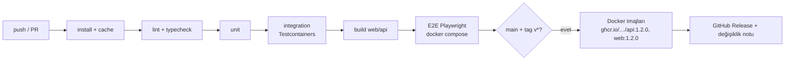

# 04 — Güvenlik/KVKK, V1 Aşamaları, V2 Hazırlığı, Riskler, Test ve Deployment

---

## 12. Güvenlik ve KVKK Kontrol Listesi

### 12.1 Uygulama güvenliği

| # | Kontrol | Uygulama |
|---|---|---|
| G-01 | Parola saklama | Argon2id (memory ≥ 19 MiB, t=2), parola asla loglanmaz |
| G-02 | Parola politikası | Min. 10 karakter, sızdırılmış/yaygın parola listesi kontrolü, kullanıcı adı/işletme adı içeremez. Zorla periyodik değişim **yok** (NIST önerisi). İlk girişte geçici parola değiştirme zorunlu. |
| G-03 | Oturum | Opak 256-bit token, cookie: `HttpOnly; Secure; SameSite=Lax; Path=/`. DB'de hash. 12 saat hareketsizlik / 7 gün mutlak süre. Parola değişince ve kullanıcı pasifleştirilince tüm oturumlar iptal. Aktif oturumlar listesi + uzaktan kapatma. |
| G-04 | Brute force | Giriş: IP başına 10/dk, hesap başına 5 hatalı denemede artan kilit (1, 5, 15 dk). Hata mesajı hesabın var olup olmadığını belli etmez. |
| G-05 | 2FA | Sahip hesabı için TOTP **önerilir** — V1 kapsamına alınıp alınmayacağı karar listesinde (K-14). |
| G-06 | Yetkilendirme | Her endpoint `@RequirePermission()` ile işaretli; işaretsiz endpoint CI'da test ile yakalanır (varsayılan: reddet). Satır seviyesi kontroller servis katmanında (örn. personel sadece aktif araç müşterisini görür). |
| G-07 | CSRF | SameSite=Lax + değiştiren isteklerde `Origin`/`Referer` doğrulaması + custom header (`X-Requested-With`) zorunluluğu. Aynı origin mimarisi (Nginx altında `/` ve `/api`). |
| G-08 | XSS | React varsayılan escape; `dangerouslySetInnerHTML` yasak (lint kuralı); e-posta şablon blokları sunucuda sanitize; sıkı **CSP** (nonce tabanlı script). |
| G-09 | SQL injection | Prisma parametreli sorgular; raw SQL sadece `$queryRaw` tagged template (string birleştirme lint ile yasak). |
| G-10 | Girdi doğrulama | Tüm DTO'lar Zod/class-validator ile; bilinmeyen alanlar reddedilir (mass assignment koruması). |
| G-11 | Rate limiting | Nginx `limit_req` (genel) + uygulama seviyesinde (giriş, public token uç noktaları, kupon doğrulama — kupon kodu deneme saldırısı). |
| G-12 | Güvenlik başlıkları | HSTS, CSP, `X-Content-Type-Options`, `Referrer-Policy: strict-origin-when-cross-origin`, `Permissions-Policy`, `frame-ancestors 'none'`. |
| G-13 | Gizli bilgiler | `.env` (sunucuda 600 izin), repoda sadece `.env.example`. Panelden girilen entegrasyon anahtarları AES-256-GCM ile şifreli. CI'da secret tarama (gitleaks). |
| G-14 | Public token'lar | 32 bayt CSPRNG, DB'de SHA-256 hash, süreli, iptal edilebilir, sayfada kişisel veri minimum (maskeli plaka, ad yok veya sadece ilk ad). `noindex` + `Referrer-Policy: no-referrer`. Public plaka arama **yok**. |
| G-15 | Webhook | HMAC imza doğrulama, ham gövde, tekrar (replay) için olay id idempotency. |
| G-16 | Dosya yükleme | Sadece görsel (MIME + magic byte kontrolü), boyut sınırı, yeniden kodlama (sharp) ile metadata temizliği, rastgele dosya adı, uygulama dizini dışında servis. |
| G-17 | Bağımlılıklar | Renovate/Dependabot, CI'da `pnpm audit` (yüksek seviye = kırmızı). |
| G-18 | Audit log | Giriş/çıkış, başarısız giriş, rol/yetki değişikliği, kullanıcı ekleme/pasifleştirme, tüm finansal işlemler ve ters kayıtlar, durum düzeltmeleri, indirim/fiyat ezme, müşteri birleştirme/silme/anonimleştirme, ayar ve entegrasyon değişikliği, dışa aktarma, toplu gönderim başlatma. Audit log uygulamadan silinemez. |
| G-19 | Loglar | pino, JSON; telefon/e-posta/token maskeleme (redact). Hata takibinde (Sentry) kişisel veri gönderimi kapalı (`sendDefaultPii=false`). |
| G-20 | Konteyner | Root olmayan kullanıcı, salt okunur dosya sistemi (mümkün olan yerlerde), PostgreSQL dışarıya port açmaz, sadece Nginx 80/443 açık. |

### 12.2 KVKK / ticari elektronik ileti (İYS)

> Aşağıdakiler teknik tasarımı yönlendiren varsayımlardır; **hukuki teyit (avukat / KVKK danışmanı) Faz 10'dan önce zorunludur.**

| # | Kontrol | Sistemdeki karşılığı |
|---|---|---|
| KV-01 | Aydınlatma yükümlülüğü | Aydınlatma metni sitede (`/kvkk`), işletmede tabela/QR, ilk WhatsApp mesajında link. Kabulde `kvkk_notice_at` kaydı. Metin versiyonlanır. |
| KV-02 | İleti türlerinin ayrımı | **Operasyonel** (kabul, hazır, takip linki) → sözleşmenin ifası / hizmet bildirimi; pazarlama izni gerekmez, ama içerikte **hiçbir tanıtım olmaz**. **Pazarlama** (kampanya, indirim, geri kazanım) → önceden alınmış açık onay + İYS. **Anket** → içerik tanıtımsız; niteliği hukuken teyit edilecek. Sistem bu üç `purpose`'u kod seviyesinde ayırır, izin kontrolü amaca göre yapılır. |
| KV-03 | Onayın kanıtı | `consent_events`: kaynak, zaman, IP/UA veya mesaj id'si, onay metninin versiyonu, işlemi yapan kullanıcı. Değiştirilemez. |
| KV-04 | Kanal bazlı izin | E-posta ve WhatsApp izinleri **ayrı**. Toplu "tüm izinler" kutusu yok. |
| KV-05 | Ret ve iptal | Her pazarlama e-postasında tek tıkla abonelikten çıkma; WhatsApp'ta "Bildirimleri durdur" butonu ve "DUR" anahtar kelimesi; panelde manuel iptal. İptal anında etkili, ücretsiz, gerekçe sormaz. |
| KV-06 | İYS | `IysProvider` arayüzü: izin ekle/iptal et, İYS'den gelen ret bildirimlerini işle, gönderim öncesi İYS durumu. Gerçek entegrasyon işletmenin İYS hesabıyla. Yasal süreler (izin kaydının İYS'ye bildirilmesi vb.) ayar olarak tutulur ve teyit edilir. |
| KV-07 | Veri minimizasyonu | Zorunlu alan sadece plaka. Telefon/e-posta/marka-model opsiyonel. Kimlik no **toplanmaz**. Kurumsal müşteride vergi no. |
| KV-08 | Erişim kontrolü | Personel müşteri listesinin tamamını dışa aktaramaz; dışa aktarma yetkisi ayrı ve audit log'lu. |
| KV-09 | Saklama süreleri | Finansal kayıtlar: vergi/ticaret mevzuatı gereği uzun süre (genelde 10 yıl — teyit edilecek). Pazarlama onay kanıtları: izin iptalinden sonra mevzuatın öngördüğü süre. Pasif müşterinin iletişim verisi: ayarlanabilir süre (örn. son ziyaretten 3 yıl) sonra **anonimleştirme** işi. Loglar: 90 gün. Yedekler: 30 gün rotasyon. |
| KV-10 | Silme / anonimleştirme | "Müşteriyi anonimleştir": ad → "Anonim Müşteri #…", telefon/e-posta silinir, notlar silinir, izinler kapatılır; siparişler ve ödemeler (finansal kayıt) **istatistik için anonim kalır**. Plaka da kişisel veri sayılabilir → maskelenir/hash'lenir. Tam silme finansal kayıt varken yapılmaz (gerekçesi kayıt altına alınır). |
| KV-11 | İlgili kişi başvurusu | Panelde "Müşteri verisini dışa aktar" (JSON/PDF) — başvuru cevabı için. |
| KV-12 | Yurt dışına aktarım | Meta (WhatsApp) ve olası e-posta servisi yurt dışında → aydınlatma metninde belirtilir, hukuki mekanizma teyit edilir. Sunucu Türkiye'de önerilir. |
| KV-13 | VERBİS | İşletmenin kayıt yükümlülüğü eşiklere bağlı — işletme sahibine bilgi notu, sistem kapsamı dışında. |
| KV-14 | Veri ihlali | Prosedür dokümanı (tespit, kayıt, Kurul'a bildirim süresi), audit log ve erişim logları buna destek verecek şekilde. |
| KV-15 | Yedeklerin korunması | Yedekler şifreli (age/gpg), sunucu dışı kopya şifreli. |

---

## 13. V1 Geliştirme Aşamaları

Her fazın "tamamlandı" sayılması için: **backend + frontend + migration + validasyon + yetki + hata yönetimi + test + modül dokümanı + durum raporu**. Ağırlıklar göreli büyüklüktür (S/M/L/XL).

| Faz | İçerik | Çıktı / kabul kriteri | Boyut |
|---|---|---|---|
| **0** | Bu dokümanın onayı, karar listesinin kapanması | Onaylı mimari, Prisma şeması taslağı incelemesi | — |
| **1** | Monorepo, Docker Compose (dev), PostgreSQL, Prisma şeması (çekirdek tablolar), CI (lint/type/test/build), tasarım sistemi temeli (renk, tipografi, layout, sidebar, mobil menü), **GitHub reposuna ilk push** | `docker compose up` ile boş panel ve site açılır, CI yeşil, mobil görünüm doğrulanmış | M |
| **2** | Auth (giriş/çıkış/oturum/parola), RBAC, audit log, kullanıcı/personel/rol ekranları, ilk kurulum komutu | E2E: giriş, yetkisiz erişim reddi (API seviyesinde) | M |
| **3** | Dashboard iskeleti (gerçek veri; araç sayıları ilk etapta, finans kartları Faz 8'de bağlanır) | Tarih filtreleri, rol bazlı kart görünürlüğü | S |
| **4** | Müşteri + araç + plaka normalizasyonu + müşteri-araç ilişkisi + notlar + birleştirme + CSV içe aktarma | Unit: plaka; integration: aynı plaka farklı yazımla tek araç | M |
| **5** | Araç kabul + durum makinesi + liste/kart görünüm + detay + personel atama + takip sayfası | E2E: kabul → durum → teslim (mobil profil dahil) | L |
| **6** | Hizmet/araç tipi/fiyat geçmişi | Fiyat değişince eski kayıt değişmez testi | S |
| **7** | WhatsApp operasyonel: outbox, worker, Meta + mock provider, webhook, şablon senkronu/eşleme, mesaj geçmişi, yeniden gönder | Integration: kuyruk, retry, idempotency, imza doğrulama; mock ile E2E | L |
| **8** | Finans: ödeme/iade, ödeme yöntemleri, kasa, gün sonu, gider, cari hesap, silinemezlik trigger'ları | Unit: tüm hesaplamalar; integration: 750 TL örneği, iade, iptal engeli, gün sonu farkı | XL |
| **9** | Raporlar (finans/operasyon/müşteri/personel) + dışa aktarma + karşılaştırma | Integration: sabit fixture veri üzerinde metriklerin beklenen değerleri | L |
| **10** | Kampanya + kupon + segment + izin yönetimi + İYS arayüzü (mock) | Unit: indirim motoru; integration: limit yarışı | M |
| **11** | E-posta: provider'lar, blok şablon, test gönderimi, broadcast, tıklama takibi, abonelikten çıkma | Mailpit ile E2E | M |
| **12** | WhatsApp pazarlama: broadcast, frekans sınırı, sessiz saat, maliyet tahmini, durdurma anahtar kelimesi | Integration: izinsiz müşteriye gönderilmeme testi | M |
| **13** | Geri kazanım otomasyonu | Integration: müşteri gelince otomasyon durur, aynı dönemde tekrar gönderilmez | M |
| **14** | Anket + şikâyet takibi + kalite raporları | Integration: düşük puan → case + bildirim; yetersiz veri kuralı | M |
| **15** | Tanıtım sitesi (10 sayfa) + panelden içerik yönetimi + SEO (meta, sitemap, robots, JSON-LD `AutoWash`/`LocalBusiness`) + WhatsApp butonu | Lighthouse mobil ≥ 90 (performans/SEO/erişilebilirlik) | M |
| **16** | Güvenlik sertleştirme, eksik test tamamlama, yük testi (k6, basit), güvenlik taraması | OWASP kontrol listesi raporu | M |
| **17** | Production: prod compose, Nginx, SSL, yedekleme/restore, güncelleme scripti, kurulum ve işletim dokümanı, pilot işletmede kurulum | Temiz sunucuda dokümanla sıfırdan kurulum provası, restore provası | M |

**Not:** Faz 7 (WhatsApp) için Meta hesap/şablon onayı süreci **Faz 1 ile paralel** başlatılmalı. Kod hazır olup onay beklemek en sık görülen gecikme sebebidir.

**Pilot önerisi:** Faz 1–8 + 15'in temel sayfaları tamamlandığında (çekirdek operasyon + finans) gerçek işletmede **gölge kullanım** (mevcut yöntemle paralel) 1–2 hafta. Pazarlama modülleri bu geri bildirimden sonra. Bu, sıralamayı değiştirmez; erken gerçek veri alınmasını sağlar.

---

## 14. V2 İçin Mimari Hazırlık

V1'de **kod/ekran yok**, sadece aşağıdaki genişleme noktaları korunur:

| V2 özelliği | V1'de hazır olan | V2'de eklenecek |
|---|---|---|
| **Sadakat** | `customers.visit_count`, teslim edilmiş sipariş geçmişi (geriye dönük sayım mümkün); indirim kaynağı modeli (kampanya/manuel) genişletilebilir yapıda | `loyalty_programs`, `loyalty_ledger` (kazanım/kullanım), sipariş kaleminde `discount_source = LOYALTY` |
| **Online randevu** | `services.duration_minutes`, `business_settings.working_hours`, araç kabul servisinin "taslaktan sipariş oluştur" ayrımı, e-posta şablon motorunda gizli `{{randevu_linki}}`, WhatsApp hatırlatma = yeni `purpose`/şablon kullanımı | `appointments`, `capacity_rules` (eşzamanlı hat sayısı), public randevu sayfası, `vehicle_orders.appointment_id` |
| **Abonelik** | `payments` siparişsiz ödemeyi destekler (`account_id` gibi), fiyat geçmişi modeli, cari hesap mantığı | `subscription_plans`, `subscriptions`, `subscription_usages`, yenileme işi (pg-boss cron), siparişte `covered_by_subscription_id` |

İlke: V2 tabloları V1 tablolarına **yeni nullable FK** ile bağlanacak; V1 verisinde migration gerekmeyecek.

---

## 15. Tahmini Teknik Zorluklar ve Riskler

| # | Risk | Olasılık / Etki | Önlem |
|---|---|---|---|
| R-01 | **Meta işletme doğrulaması ve şablon onayı gecikmesi** | Yüksek / Orta | Süreci hemen başlat; mock provider ile geliştirme bağımsız; mesaj gönderilemese de operasyon çalışır. |
| R-02 | **Meta fiyat ve politika değişiklikleri** (kategori yeniden sınıflandırma, pazarlama limitleri) | Yüksek / Orta | Kategori ve birim maliyet ayardan; şablon kategorisi Meta'dan senkron; maliyet tahmini ekranı. |
| R-03 | **Hukuki belirsizlik (anket, İYS, yurt dışı aktarım)** | Orta / Yüksek (idari para cezası) | Purpose ayrımı kodda; pazarlama varsayılan **kapalı**; hukuki teyit Faz 10 öncesi kapı (gate). |
| R-04 | **Sahada benimsenme** — personel sistemi yavaş bulursa kullanmaz, veri eksik kalır, raporlar anlamsızlaşır | Yüksek / Yüksek | Kabul ≤ 30 sn hedefi, büyük dokunmatik butonlar, plaka ile tek adımda müşteri getirme, pilotta gözlem ve ölçüm. **Bu projenin bir numaralı ticari riskidir.** |
| R-05 | Finansal hesap hataları (yuvarlama, iade, eşzamanlı ödeme) | Orta / Yüksek | Kuruş tamsayı, saf fonksiyonlar + kapsamlı unit test, idempotency key, silinemezlik trigger'ı, gece mutabakat kontrolü. |
| R-06 | Saat dilimi hataları (gece 00:00–03:00 arası işlemler yanlış güne düşer) | Orta / Orta | Tek yardımcı modül, `business_date` kolonları, sınır saatlerini kapsayan testler. |
| R-07 | E-posta teslim edilebilirliği (spam'e düşme) | Yüksek / Orta | SPF/DKIM/DMARC rehberi, düşük hacim, gerçek izinli liste, tek tıkla çıkış, webhook destekli servis önerisi. |
| R-08 | İnternet kesintisi / sunucu erişilemezliği | Orta / Yüksek | VPS + izleme (uptime), hızlı restore prosedürü; kesinti anında kâğıda not alınıp sonradan girilmesi için "geçmiş tarihli kabul" yetkisi (audit log'lu). |
| R-09 | Veri kaybı | Düşük / Çok yüksek | Günlük şifreli yedek + sunucu dışı kopya + **aylık restore provası**. |
| R-10 | Kapsam kayması (V2 veya "gelecek" özelliklerin araya girmesi) | Yüksek / Orta | Bu doküman sözleşme niteliğinde; yeni talepler değişiklik listesine. |
| R-11 | Çok kurulumlu bakım yükü (her işletme ayrı sunucu) | Orta (ileride) / Orta | Sürümlü imaj, tek komut güncelleme, migration'ların geriye uyumlu yazılması, kurulum envanteri. |
| R-12 | Tek geliştirici bağımlılığı | Orta / Yüksek | Dokümantasyon, test kapsamı, standart araçlar, CI. |
| R-13 | Mevcut müşteri verisinin kalitesi (içe aktarma) | Orta / Düşük | İçe aktarmada önizleme, hata satırları raporu, telefon normalizasyonu. |

---

## 16. Test ve Deployment Stratejisi

### 16.1 Test piramidi

| Seviye | Araç | Kapsam | CI'da |
|---|---|---|---|
| Unit | Vitest | `packages/shared` (para, plaka, durum makinesi, indirim, segment kuralları), servis içi saf mantık, yetki matrisi | Her push |
| Integration | Vitest + **Testcontainers PostgreSQL** + Nest test modülü | Araç kabul transaction'ı, ödeme/iade/iptal, kasa gün sonu, outbox → mock provider, webhook imza, kampanya limit yarışı, otomasyon durdurma, anket → case, rapor metrikleri (sabit fixture ile beklenen sayılar) | Her push |
| E2E | Playwright (Chromium masaüstü + **mobil profil** Pixel/iPhone) | Giriş, araç kabul, durum değiştirme, teslim, ödeme alma, müşteri geçmişi, sahip raporları, yetkisiz kullanıcının rapora erişememesi | PR ve main |
| Güvenlik | gitleaks, `pnpm audit`, yetkisiz endpoint testi (tüm route'ları dolaşıp işaretsiz olanı bulan test) | | Her push |
| Erişilebilirlik / performans | axe (Playwright), Lighthouse CI (site sayfaları) | | main |

Kurallar: Finans ve durum makinesi için **dal kapsamı ≥ %90**; genel hedef ≥ %70 (sayı amacı değil, kritik yerlerde zorunlu). Test edilmemiş modül durum raporunda "tamamlandı" yazılmaz.

### 16.2 Ortamlar

| Ortam | Amaç |
|---|---|
| `development` | Yerel: `docker compose up` (PostgreSQL + Mailpit), uygulamalar `pnpm dev` ile; mock WhatsApp; seed örnek veri |
| `staging` | Production ile aynı compose, test alan adı, Meta test numarası, gerçek e-posta servisinin test modu |
| `production` | İşletme sunucusu; seed sadece roller/yetkiler/varsayılanlar (örnek veri **asla**) |

### 16.3 CI/CD (GitHub Actions)

Deploy otomatik **değil** (işletme sunucuları müşteriye ait): sunucuda `./infra/scripts/update.sh 1.2.0`.

### 16.4 Production yapılandırması

`docker-compose.prod.yml` servisleri: `nginx` (80/443, Certbot sertifikaları), `web`, `api`, `worker`, `postgres` (sadece iç ağ, volume), `backup` (cron'lu pg_dump konteyneri).

**Kurulum (özet, ayrıntılı doküman Faz 17'de):**

1. Ubuntu LTS sunucu, Docker kurulumu, firewall (sadece 22/80/443), SSH anahtar girişi.
2. Alan adı DNS → sunucu.
3. `.env` doldurma (`.env.example` üzerinden; `APP_ENCRYPTION_KEY`, DB parolası, alan adı, Sentry DSN vb.).
4. `install.sh`: imajları çek → `prisma migrate deploy` → prod seed → sahip hesabı oluştur → Certbot ile SSL → servisleri başlat.
5. Panelden: işletme bilgileri, logo, renkler, hizmetler/fiyatlar, WhatsApp/e-posta entegrasyon ayarları ve test.

**Güncelleme prosedürü (`update.sh <sürüm>`):** ön kontrol (disk, sağlık) → **otomatik yedek** → imaj çek → migration (`migrate deploy`) → servisleri yeniden başlat → sağlık kontrolü → başarısızsa önceki imaja dönüş ve yedekten restore talimatı. Migration'lar geriye uyumlu yazılır (kolon silme iki sürümde: önce kullanımı kaldır, sonra sil).

**Yedekleme:** Günlük 03:00 `pg_dump -Fc` → `age` ile şifreleme → yerel 14 gün + sunucu dışı (S3 uyumlu depolama / rclone hedefi) 30 gün. `uploads` volume'ü de dahil. Yedek başarısızsa panelde sahip için uyarı + (yapılandırıldıysa) e-posta. **Restore:** `restore.sh <dosya>` → bakım modu → restore → migration → doğrulama. Aylık restore provası kontrol listesi.

**Log yönetimi:** Docker `json-file` sürücüsü, `max-size=20m, max-file=5`; uygulama logları JSON; Nginx access log rotasyonu (logrotate). Merkezi log sistemi opsiyonel.

**İzleme:** `/api/v1/system/health` (DB, kuyruk gecikmesi, son yedek zamanı, son başarılı WhatsApp gönderimi) → harici uptime servisi; Sentry hata bildirimi.

### 16.5 GitHub

- Repo'yu siz oluşturacaksınız. Önerilen ad: `kuzhan-oto-yikama` (private).
- Dal stratejisi: `main` (her zaman yayınlanabilir) + özellik dalları (`feat/faz-05-arac-kabul`) + PR + CI zorunlu. Sürümler `v1.0.0` etiketleriyle.
- Faz 1 tamamlandığında repo URL'sini paylaşmanız yeterli; `origin` olarak ekleyip ilk push'u yapacağım. Kimlik bilgisi/token benimle paylaşılmamalı — push sizin makinenizdeki Git kimlik doğrulamasıyla yapılır.
